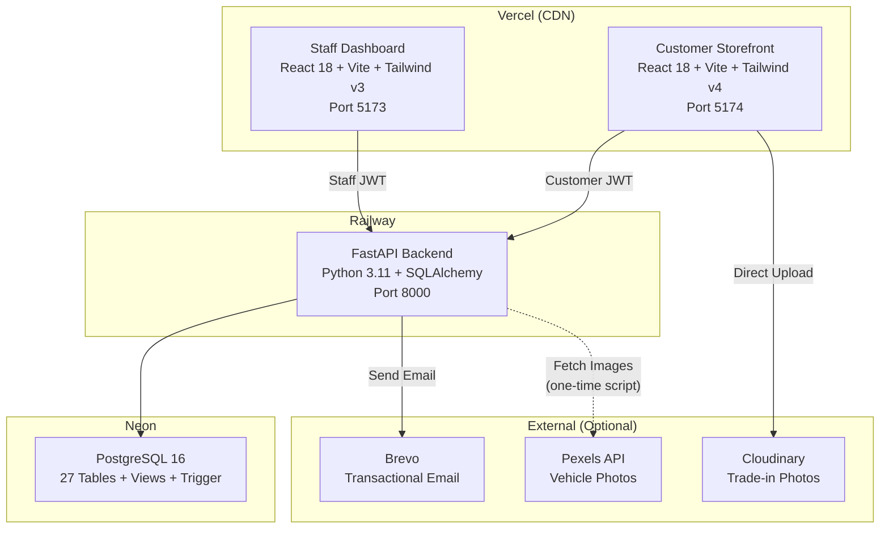

# AutoEdge — Car Showroom Management System

> A full-stack car dealership platform with a **Staff Dashboard** for internal operations and a **Customer Storefront** for public browsing, reservations, test drives, service bookings, and more.

**Course:** Database Systems  
**Author:** Mustafa Shams  
**Live URLs:** *(add after Vercel deployment)*  
- Staff Dashboard: `https://your-staff-url.vercel.app`
- Customer Storefront: `https://your-storefront-url.vercel.app`
- Backend API: `https://your-railway-url.up.railway.app`
- API Docs: `https://your-railway-url.up.railway.app/docs`

---

## Architecture



---

## Tech Stack

| Layer | Technology |
|---|---|
| Staff Frontend | React 18, Vite 8, Tailwind CSS v3, Shadcn/ui |
| Customer Storefront | React 18, Vite 8, Tailwind CSS v4 |
| Backend API | FastAPI, SQLAlchemy 2.0, Alembic, Pydantic v2 |
| Database | PostgreSQL 16 (Neon), 27 normalised tables |
| Auth | JWT Bearer tokens (24h expiry), bcrypt hashing |
| Hosting | Vercel (frontends) + Railway (backend) + Neon (database) |
| Email | Brevo (optional — works without it via in-app notifications) |
| Image Upload | Cloudinary (unsigned preset for trade-in photos) |

---

## ER Diagram (27 Tables)

```mermaid
erDiagram
    %% ── Staff / Core ──
    users {
        int user_id PK
        string full_name
        string email UK
        string password_hash
        string role
        boolean is_active
        boolean handles_enquiries
    }

    vehicles {
        int vehicle_id PK
        string make
        string model
        int year
        string color
        decimal price
        int stock_quantity
        string status
        string body_type
        string fuel_type
        string transmission
        string condition_type
        string engine
        int horsepower
        int seats
        string drivetrain
        boolean is_published
        string main_image_url
        text description
        int mileage_km
    }

    customers {
        int customer_id PK
        string full_name
        string email
        string phone
    }

    sales {
        int sale_id PK
        int vehicle_id FK
        int customer_id FK
        int user_id FK
        decimal total_price
        string payment_method
        int reservation_id FK
        int trade_in_id FK
    }

    test_drives {
        int test_drive_id PK
        int vehicle_id FK
        int customer_id FK
        int user_id FK
        string status
        timestamp scheduled_at
        timestamp expires_at
    }

    service_jobs {
        int job_id PK
        int vehicle_id FK
        string description
        string status
        int assigned_to FK
        int service_booking_id FK
    }

    service_parts {
        int part_id PK
        int job_id FK
        string name
        int quantity
        decimal unit_price
    }

    commissions {
        int commission_id PK
        int sale_id FK
        int user_id FK
        decimal amount
        string status
    }

    %% ── Storefront ──
    customer_accounts {
        int account_id PK
        int customer_id FK UK
        string email UK
        string password_hash
        boolean is_active
        boolean email_verified
    }

    vehicle_images {
        int image_id PK
        int vehicle_id FK
        string image_url
        int sort_order
        string credit
    }

    reservations {
        int reservation_id PK
        int customer_id FK
        int vehicle_id FK
        decimal deposit_amount
        int hold_days
        string status
        timestamp expires_at
    }

    bank_accounts {
        int bank_account_id PK
        int customer_id FK UK
        string account_number UK
        string card_last4
        decimal balance
    }

    bank_transactions {
        int txn_id PK
        int bank_account_id FK
        string txn_type
        string direction
        decimal amount
        decimal balance_after
        string reference_code UK
        int reservation_id FK
    }

    stock_movements {
        int movement_id PK
        int vehicle_id FK
        int change_qty
        string reason
        int reference_id
    }

    restock_requests {
        int request_id PK
        int customer_id FK
        int vehicle_id FK
        string status
    }

    enquiries {
        int enquiry_id PK
        int customer_id FK
        int vehicle_id FK
        string subject
        string status
        int assigned_to FK
    }

    enquiry_messages {
        int message_id PK
        int enquiry_id FK
        string sender_type
        int sender_user_id FK
        text body
    }

    trade_in_requests {
        int trade_in_id PK
        int customer_id FK
        string make
        string model
        int year
        string status
        decimal expected_price
        decimal offered_price
    }

    trade_in_images {
        int image_id PK
        int trade_in_id FK
        string image_url
        int sort_order
    }

    reviews {
        int review_id PK
        int vehicle_id FK
        int customer_id FK
        int rating
        string title
        text body
        boolean is_visible
    }

    wishlist_items {
        int wishlist_id PK
        int customer_id FK
        int vehicle_id FK
    }

    customer_vehicles {
        int cv_id PK
        int customer_id FK
        string make
        string model
        int year
    }

    service_types {
        int service_type_id PK
        string name
        decimal base_price
        decimal booking_fee
        int duration_minutes
    }

    technician_profiles {
        int profile_id PK
        int user_id FK UK
        string specialty
        int years_experience
        boolean is_bookable
    }

    service_bookings {
        int booking_id PK
        int customer_id FK
        int cv_id FK
        int service_type_id FK
        int technician_user_id FK
        date booking_date
        string time_slot
        string status
        decimal fee_charged
        int service_job_id FK
    }

    notifications {
        int notification_id PK
        int customer_id FK
        string type
        string title
        text message
        boolean is_read
    }

    email_outbox {
        int email_id PK
        string to_email
        string subject
        string status
        int customer_id FK
    }

    %% ── Relationships ──
    vehicles ||--o{ vehicle_images : "has photos"
    vehicles ||--o{ reservations : "reserved"
    vehicles ||--o{ stock_movements : "tracked"
    vehicles ||--o{ restock_requests : "requested"
    vehicles ||--o{ reviews : "reviewed"
    vehicles ||--o{ wishlist_items : "wishlisted"
    vehicles ||--o{ sales : "sold"
    vehicles ||--o{ test_drives : "test driven"
    vehicles ||--o{ service_jobs : "serviced"
    vehicles ||--o{ enquiries : "enquired about"

    customers ||--o| customer_accounts : "has login"
    customers ||--o| bank_accounts : "has bank"
    customers ||--o{ reservations : "makes"
    customers ||--o{ restock_requests : "requests"
    customers ||--o{ reviews : "writes"
    customers ||--o{ wishlist_items : "saves"
    customers ||--o{ enquiries : "asks"
    customers ||--o{ trade_in_requests : "submits"
    customers ||--o{ customer_vehicles : "owns"
    customers ||--o{ service_bookings : "books"
    customers ||--o{ notifications : "receives"
    customers ||--o{ email_outbox : "emailed"
    customers ||--o{ test_drives : "takes"
    customers ||--o{ sales : "buys"

    bank_accounts ||--o{ bank_transactions : "records"
    reservations ||--o{ bank_transactions : "charged"
    trade_in_requests ||--o{ trade_in_images : "has photos"

    enquiries ||--o{ enquiry_messages : "has messages"
    users ||--o{ enquiry_messages : "sends"
    users ||--o{ enquiries : "assigned"
    users ||--o| technician_profiles : "has profile"
    users ||--o{ service_jobs : "works on"
    users ||--o{ test_drives : "conducts"
    users ||--o{ sales : "closes"
    users ||--o{ commissions : "earns"

    service_types ||--o{ service_bookings : "booked as"
    customer_vehicles ||--o{ service_bookings : "serviced"
    technician_profiles ||--o{ service_bookings : "assigned"
    service_bookings ||--o| service_jobs : "creates job"
    service_jobs ||--o{ service_parts : "uses"
    sales ||--o{ commissions : "generates"
    sales }o--o| reservations : "from reservation"
    sales }o--o| trade_in_requests : "with trade-in"
```

---

## Features

### Staff Dashboard (Existing — Phases P01–P29)
- **Inventory Management** — Vehicle CRUD, photo gallery, stock tracking
- **Sales Pipeline** — Record sales, track payment methods, link reservations and trade-ins
- **Test Drive Scheduling** — Booking, staff assignment, confirm/decline/complete
- **Service & Maintenance** — Job management, parts tracking, technician assignment
- **Commission & Performance** — Auto-commission on sales, approval workflow
- **Customer Management** — Full CRM with interaction history
- **Reservations Staff View** — All reservations, approve conversions
- **Restock Priority** — See which out-of-stock cars customers want most
- **Review Moderation** — Approve, hide, or flag customer reviews
- **Enquiry Management** — Two-way threaded conversations with customers
- **Trade-in Management** — Appraise, make offers, accept/reject
- **Service Booking Management** — Confirm bookings, link to service jobs
- **Email Log** — View all sent/suppressed/failed transactional emails

### Customer Storefront (New — Phases P30–P48)
- **Public Catalog** — Browse, filter, sort, search cars with Pexels photos + fallback
- **Car Detail Pages** — Image gallery, specs table, stock badge, reviews, photographer credits
- **Compare Cars** — Side-by-side comparison (up to 4 vehicles)
- **EMI Calculator** — Interactive loan estimator with down payment and interest sliders
- **Account System** — Signup, login, profile management (token in sessionStorage)
- **Demo Bank** — Simulated bank account with balance, top-ups, and transaction history
- **Reservations** — Reserve a car with 10% deposit, 7–30 day hold, cancel with 10% fee, auto-expire
- **Test Drive Requests** — Request a test drive, auto-expires after 48h if not confirmed
- **Wishlist** — Save favourite cars to your account
- **Reviews & Ratings** — One per car per customer, verified badge, star ratings
- **Enquiries** — Threaded inbox to chat with staff about any car
- **Trade-in Requests** — Submit trade-in with Cloudinary photos, receive offers, accept/reject
- **Service Bookings** — Book services for your garage vehicles, pick technician and time slot
- **My Garage** — Manage your vehicles (from purchases and trade-ins)
- **Notifications** — In-app notification centre with unread count and bell icon
- **Restock Alerts** — Request restock for out-of-stock cars, get notified when available
- **Responsive Design** — Fully mobile-responsive down to 375px
- **Accessibility** — All form labels associated, aria attributes, keyboard navigation

---

## Database Features (for the teacher)

1. **27 normalised tables** with primary keys, foreign keys (`RESTRICT` / `CASCADE` / `SET NULL` chosen deliberately) and `CHECK` constraints.
2. **Partial unique indexes** — one active reservation per customer per car, one open restock request, no double-booked test-drive or technician slot.
3. A PL/pgSQL **trigger** keeping `vehicles.status` consistent with stock.
4. **Views** (`v_vehicle_catalog`, `v_restock_priority`) used by the API.
5. **Transactions** with `SELECT ... FOR UPDATE`, a fixed lock order, and an idempotency key (reserve, cancel, expire, pay service fee, complete sale).
6. **Ledger tables** (`bank_transactions`, `stock_movements`) giving a full audit trail; `CHECK (balance >= 0)` as DB-level protection.
7. **Concurrency test** proving no overselling.
8. **Aggregations and joins:** ratings, restock ranking, dashboard KPIs, customer history.
9. **Indexes** on every foreign key and on status/date columns, with the reason in comments.

---

## Roles & Access

### Staff Roles

| Role | Access |
|---|---|
| `manager` | Full access to all modules |
| `sales_executive` | Vehicles, Customers, Test Drives, Sales, Commissions, Enquiries |
| `technician` | Service Jobs (own assignments only) |
| `receptionist` | Customers, Test Drives, Service Jobs, Enquiries |

### Customer Role
Customers authenticate via `/store/auth/login` and receive a separate JWT with `scope: "customer"`. Customer tokens cannot access staff endpoints, and staff tokens cannot access store endpoints.

---

## Demo Logins

### Staff Accounts (password: `Admin@1234`)

| Email | Role |
|---|---|
| admin@autoedge.com | manager |
| sarah@autoedge.com | sales_executive |
| tom@autoedge.com | technician |
| rita@autoedge.com | receptionist |

### Customer Accounts (password: `Demo@1234`)

| Email | Name | Starting Balance |
|---|---|---|
| demo1@example.com | Ali Raza | $50,000.00 |
| demo2@example.com | Sarah Khan | $50,000.00 |
| demo3@example.com | Omar Farooq | $50,000.00 |

> **Note:** This is a demo project — no real money is involved. The bank accounts use simulated balances.

---

## Local Development

### Prerequisites
- Python 3.11
- Node.js 18+
- PostgreSQL (or Neon free tier)

### Backend

```bash
cd backend
python -m venv venv
venv\Scripts\activate          # Windows
# source venv/bin/activate    # macOS/Linux
pip install -r requirements.txt
cp .env.example .env           # Fill in DATABASE_URL and SECRET_KEY
alembic upgrade head
python database/storefront_seed.py   # Seed demo data (idempotent)
uvicorn app.main:app --reload --port 8000
```

### Staff Frontend

```bash
cd frontend
npm install
cp .env.example .env           # Set VITE_API_BASE_URL=http://localhost:8000
npm run dev                    # → http://localhost:5173
```

### Customer Storefront

```bash
cd storefront
npm install
cp .env.example .env           # Set VITE_API_BASE_URL=http://localhost:8000
npm run dev                    # → http://localhost:5174
```

### Dev URLs

| Service | URL |
|---|---|
| Staff Dashboard | http://localhost:5173 |
| Customer Storefront | http://localhost:5174 |
| Backend API | http://localhost:8000 |
| Swagger Docs | http://localhost:8000/docs |
| ReDoc | http://localhost:8000/redoc |

---

## API Namespaces

| Prefix | Auth | Description |
|---|---|---|
| `/api/v1/auth` | None | Staff login |
| `/api/v1/users` | Staff JWT | User CRUD |
| `/api/v1/vehicles` | Staff JWT | Vehicle CRUD |
| `/api/v1/customers` | Staff JWT | Customer management |
| `/api/v1/test-drives` | Staff JWT | Test drive management |
| `/api/v1/sales` | Staff JWT | Sales recording |
| `/api/v1/service` | Staff JWT | Service jobs |
| `/api/v1/commissions` | Staff JWT | Commission workflow |
| `/api/v1/dashboard` | Staff JWT | Dashboard KPIs |
| `/api/v1/reservations` | Staff JWT | Staff reservation view |
| `/api/v1/restock/priority` | Staff JWT | Restock priority ranking |
| `/api/v1/reviews/moderation` | Staff JWT | Review moderation |
| `/api/v1/enquiries` | Staff JWT | Enquiry management |
| `/api/v1/trade-ins` | Staff JWT | Trade-in management |
| `/api/v1/service-bookings` | Staff JWT | Service booking management |
| `/api/v1/email-log` | Staff JWT | Email log |
| `/api/v1/technician-profiles` | Staff JWT | Technician profiles |
| `/api/v1/public/catalog` | None | Public vehicle catalog + filters |
| `/api/v1/store/auth` | None | Customer signup/login |
| `/api/v1/store/me` | Customer JWT | Profile management |
| `/api/v1/store/bank` | Customer JWT | Bank account & transactions |
| `/api/v1/store/reservations` | Customer JWT | Reserve, cancel, view |
| `/api/v1/store/test-drives` | Customer JWT | Test drive requests |
| `/api/v1/store/wishlist` | Customer JWT | Wishlist |
| `/api/v1/store/reviews` | Customer JWT | Submit/view reviews |
| `/api/v1/store/enquiries` | Customer JWT | Enquiry threads |
| `/api/v1/store/trade-ins` | Customer JWT | Trade-in submissions |
| `/api/v1/store/garage` | Customer JWT | Customer vehicle garage |
| `/api/v1/store/service-bookings` | Customer JWT | Service bookings |
| `/api/v1/store/restock-requests` | Customer JWT | Restock requests |
| `/api/v1/store/notifications` | Customer JWT | Notification centre |
| `/health` | None | Health check |

---

## Deployment

### Backend (Railway)
- Root Directory: `/backend`
- Build: `pip install -r requirements.txt`
- Start: `uvicorn app.main:app --host 0.0.0.0 --port $PORT`
- Env vars: `DATABASE_URL`, `SECRET_KEY`, `CORS_ORIGINS`, `STORE_BASE_URL`, email settings (see `.env.example`)

### Staff Frontend (Vercel — Project 1)
- Root Directory: `frontend`
- Framework: Vite
- Env vars: `VITE_API_BASE_URL` = Railway backend URL

### Customer Storefront (Vercel — Project 2)
- Root Directory: `storefront`
- Framework: Vite
- Env vars: `VITE_API_BASE_URL` = Railway backend URL, `VITE_CLOUDINARY_CLOUD_NAME`, `VITE_CLOUDINARY_UPLOAD_PRESET`

### Database (Neon)
- PostgreSQL 16 free tier
- Run `alembic upgrade head` then `python database/storefront_seed.py` once

---

## Tests

```bash
cd backend
venv\Scripts\python.exe -m pytest tests\ -v --tb=short
```

**99 tests** across 7 test files:
- `test_routes.py` — API endpoint smoke tests
- `test_store_auth.py` — Customer registration, login, profile, token isolation
- `test_reservations.py` — Reserve, cancel, expire, idempotency, receipt, bank
- `test_race.py` — Concurrency / no overselling
- `test_cross_token.py` — Customer tokens rejected on staff routes and vice versa
- `test_ownership.py` — Customer A cannot see Customer B's data (404 not 403)
- `test_expiry.py` — Expired reservations, test drives, and trade-in offers

---

## Project Structure

```
Auto Edge Car Showroom/
├── backend/
│   ├── app/
│   │   ├── api/
│   │   │   ├── routes/          # Staff API routes
│   │   │   ├── routes/public/   # Public catalog API
│   │   │   ├── routes/store/    # Customer storefront API
│   │   │   └── deps.py          # Auth dependencies
│   │   ├── core/                # Config, security, time utils
│   │   ├── db/                  # Database session, base
│   │   ├── models/              # SQLAlchemy models (25 files)
│   │   ├── schemas/             # Pydantic schemas
│   │   ├── services/            # Business logic layer
│   │   └── main.py              # FastAPI app
│   ├── alembic/                 # Database migrations
│   ├── database/                # Schema docs, seed scripts, images
│   ├── tests/                   # Pytest test suite (99 tests)
│   └── requirements.txt
├── frontend/                    # Staff dashboard (React + Vite)
│   ├── src/
│   │   ├── pages/               # Dashboard pages
│   │   ├── api/                 # API client modules
│   │   └── components/          # Shared UI components
│   └── vercel.json              # SPA rewrite
├── storefront/                  # Customer storefront (React + Vite)
│   ├── src/
│   │   ├── pages/
│   │   │   ├── public/          # Home, Cars, Detail, Compare, EMI, etc.
│   │   │   └── account/         # Bank, Reservations, Reviews, etc.
│   │   ├── api/                 # API client modules
│   │   ├── components/          # Shared components
│   │   ├── context/             # Auth, Compare contexts
│   │   └── hooks/               # Custom hooks
│   └── vercel.json              # SPA rewrite
├── docs/
│   ├── HANDOFF.md               # Session handoff state
│   └── DECISIONS.md             # Design decisions log
├── AUTOEDGE_STOREFRONT_SPEC.md  # Full specification
└── README.md                    # This file
```

---

## License

This project was built for a Database Systems course and is not intended for production use.
